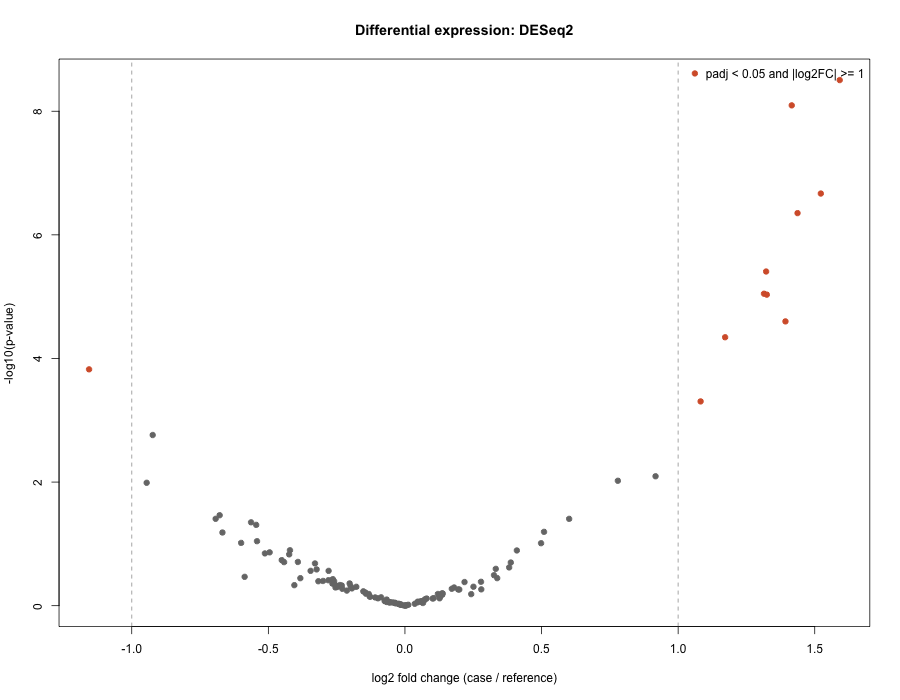

# Bioinformatics R Recipes

Find a small, runnable R example by the task you need to do. Each recipe uses base R, includes input checks, and runs a synthetic demo without downloading data.

**Start here:** install R 4.1 or newer, clone this repository, and run a recipe from the repository root:

```bash
git clone https://github.com/rsuag/bioinformatics-r-recipes.git
cd bioinformatics-r-recipes
Rscript recipes/explore_counts.R
Rscript tests/run_tests.R
```

## Complete example

For an end-to-end analysis, start with [RNA-seq: count matrix to QC and DESeq2 results](workflows/rnaseq/README.md). It includes a tiny synthetic count matrix and sample sheet, exact commands, PCA and volcano plots, and output file descriptions. It requires DESeq2; the standalone recipes below use only base R.

For a real file-format example, try the [owner-approved paired seagrass FASTQ excerpts](workflows/rnaseq/real_fastq/README.md) with the [FASTQ QC command](workflows/rnaseq/fastq_qc.R). These first-read excerpts are separate from the synthetic count matrix and are not inputs for differential expression.



## Find a Recipe

Each link opens a standalone script. Choose a task, run its demo with `Rscript`, then `source()` it and call the named function with your own data. All 14 examples use base R and synthetic data.

| I need to... | Recipe | Input | Result |
|---|---|---|---|
| Check a count matrix and explore sample structure | [Explore counts](recipes/explore_counts.R) | Genes × samples, nonnegative counts | Library sizes, log-CPM, PCA |
| Cluster molecular samples | [Cluster samples](recipes/cluster_samples.R) | Features × samples numeric matrix | Standardized distances and clustering tree |
| Estimate a mean with uncertainty | [Bootstrap mean](recipes/bootstrap_mean.R) | Independent numeric measurements | Mean and bootstrap interval |
| Control false discoveries across many tests | [Adjust p-values](recipes/adjust_pvalues.R) | A vector of p-values | Benjamini–Hochberg q-values |
| Test whether selected genes are enriched in pathways | [Gene-set enrichment](recipes/gene_set_enrichment.R) | Selected genes, gene sets, measured universe | Hypergeometric p-values and q-values |
| Estimate a proportion with uncertainty | [Beta-binomial update](recipes/beta_binomial.R) | Successes and total trials | Posterior mean and credible interval |
| Estimate transitions between discrete states | [Markov transitions](recipes/markov_transitions.R) | State sequence | Transition counts and probabilities |
| Evaluate a binary classifier without train/test leakage | [Logistic classifier](recipes/logistic_classifier.R) | Labeled feature table | Held-out predictions and metrics |
| Read FASTA and calculate GC content | [FASTA GC](recipes/fasta_gc.R) | DNA FASTA | Per-sequence length and GC fraction |
| Count short DNA words | [K-mer frequencies](recipes/kmer_frequencies.R) | DNA sequence and k | Overlapping k-mer counts |
| Summarize diploid variants | [Variant allele frequency](recipes/variant_allele_frequency.R) | Variants × samples genotype dosages | Alternate frequency and missingness |
| Compare normalized transcript expression | [Differential expression](recipes/differential_expression.R) | Genes × samples log2 expression, two groups | Log2 difference, Welch p-values, q-values |
| Audit missing metabolomics measurements | [Metabolomics missingness](recipes/metabolomics_missingness.R) | Features × samples intensity matrix | Missingness report and observed-value log transform |
| Compare metabolite intensities | [Metabolomics fold change](recipes/metabolomics_fold_change.R) | Features × samples intensity matrix, two groups | Median log2 difference and fold change |

Open a recipe to see its function signature and a self-contained example. To use your own data, `source()` the script and call its function with the input shape described in its header. For example:

```r
source("recipes/adjust_pvalues.R")
adjust_pvalues(c(gene_a = 0.001, gene_b = 0.08, gene_c = 0.02))
```

For a file-based example, run:

```bash
Rscript recipes/fasta_gc.R data/toy_sequences.fasta
```

## Scope and Scientific Boundaries

These are teaching-sized building blocks, not validated end-to-end analysis pipelines. The count-matrix PCA is exploratory. The differential-expression example accepts **already normalized log2 expression**, not raw counts; real RNA-seq analyses need a suitable count model, biological replication, and checks for batch effects. The enrichment example requires the measured-gene universe. The classifier uses synthetic data and a held-out test split; real studies need external validation and checks for batch effects and data leakage. The metabolomics examples leave missing measurements as missing.

This independent repository is organized around themes in Sunil K. Mathur's [*Statistical Bioinformatics with R*, 2nd edition](https://shop.elsevier.com/books/statistical-bioinformatics-with-r/mathur/978-0-443-40437-5) (Academic Press, 2026), including exploratory analysis, statistical methods, Bayesian methods, AI/machine learning, sequence analysis, and omics. All code and synthetic examples here are original; this is not the book's official companion repository and does not reproduce its code or datasets.

## Contributing

Add one focused, independently runnable recipe per task. Include a synthetic demo, input checks, the expected input shape, and a test that checks a scientific invariant. Keep the task table above current.

## License

Original code in this repository is available under the MIT License. See [LICENSE](LICENSE).
