# Recipe result gallery

Every standalone recipe has a result figure generated from synthetic or bundled example data. Rebuild all figures from the repository root with:

```bash
Rscript scripts/render_recipe_figures.R
```

The figures show the result type and expected shape; they are not biological findings.

| Recipe | Example result |
|---|---|
| [Adjust p-values](../recipes/adjust_pvalues.R) | 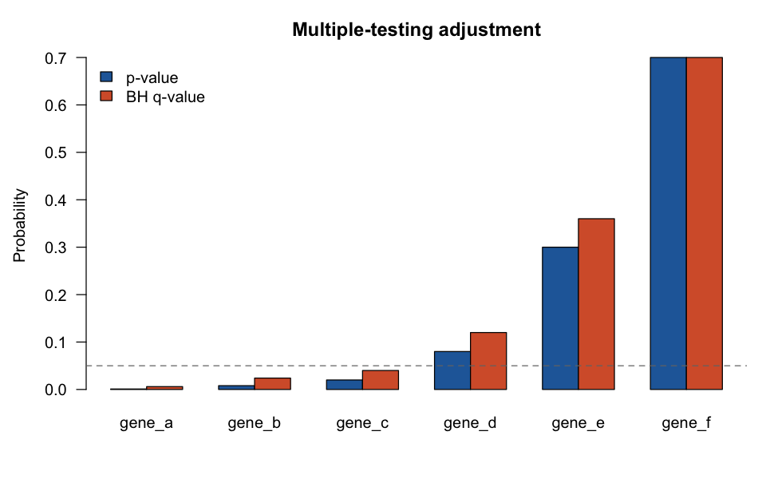 |
| [Beta-binomial update](../recipes/beta_binomial.R) | 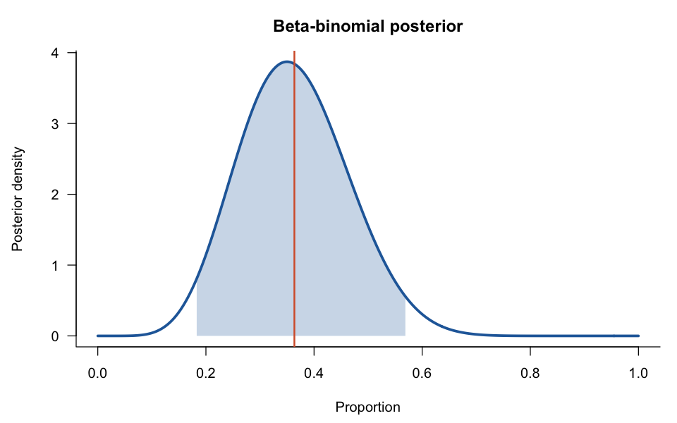 |
| [Bootstrap mean](../recipes/bootstrap_mean.R) | 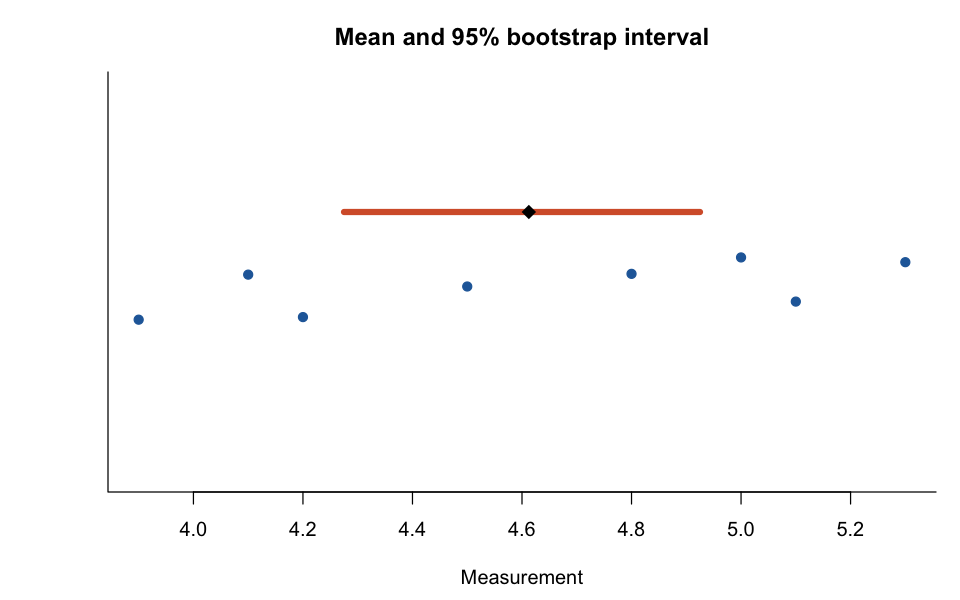 |
| [Cluster samples](../recipes/cluster_samples.R) | 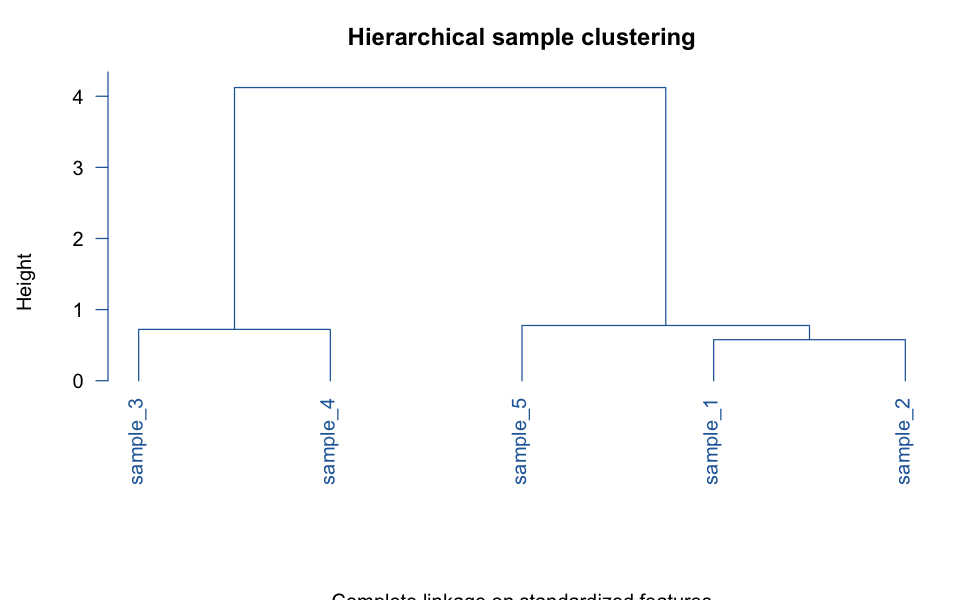 |
| [Differential expression](../recipes/differential_expression.R) | 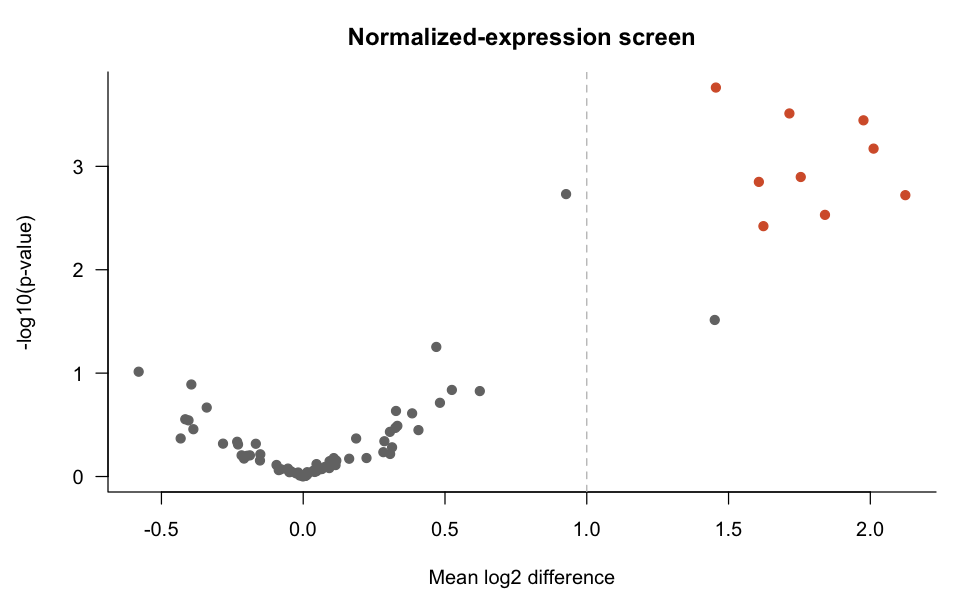 |
| [Explore counts](../recipes/explore_counts.R) | 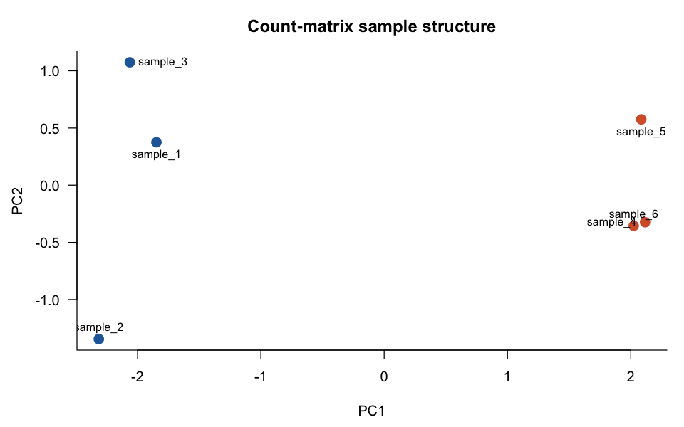 |
| [FASTA GC](../recipes/fasta_gc.R) | 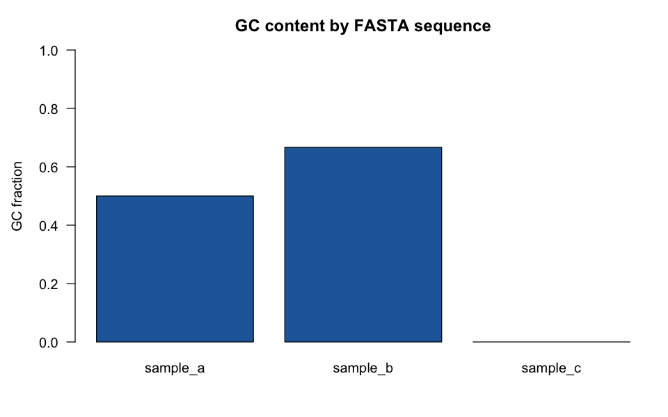 |
| [Gene-set enrichment](../recipes/gene_set_enrichment.R) | 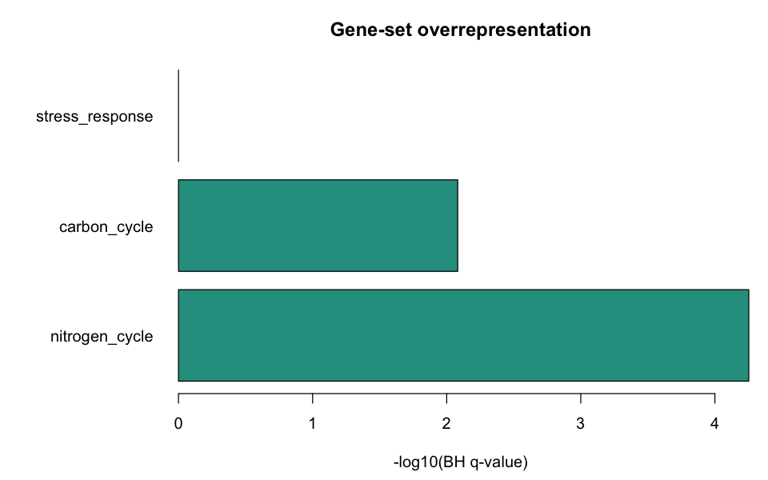 |
| [K-mer frequencies](../recipes/kmer_frequencies.R) | 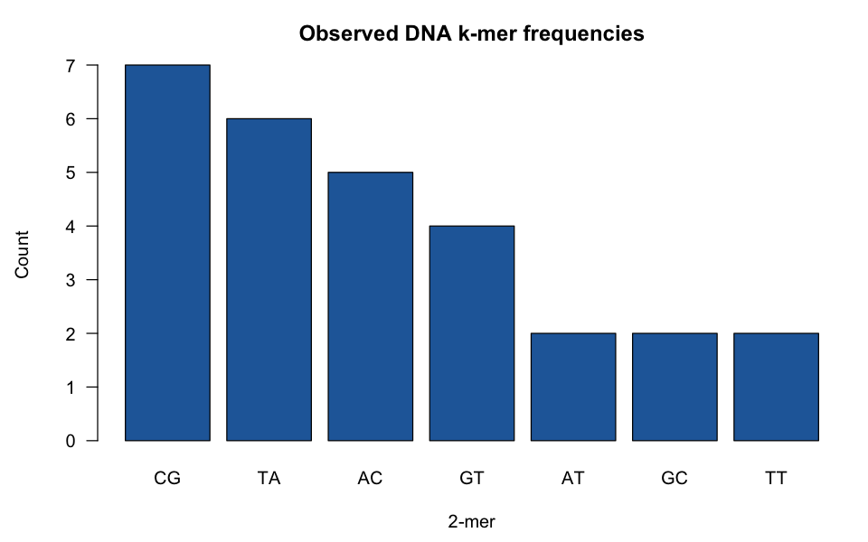 |
| [Logistic classifier](../recipes/logistic_classifier.R) | 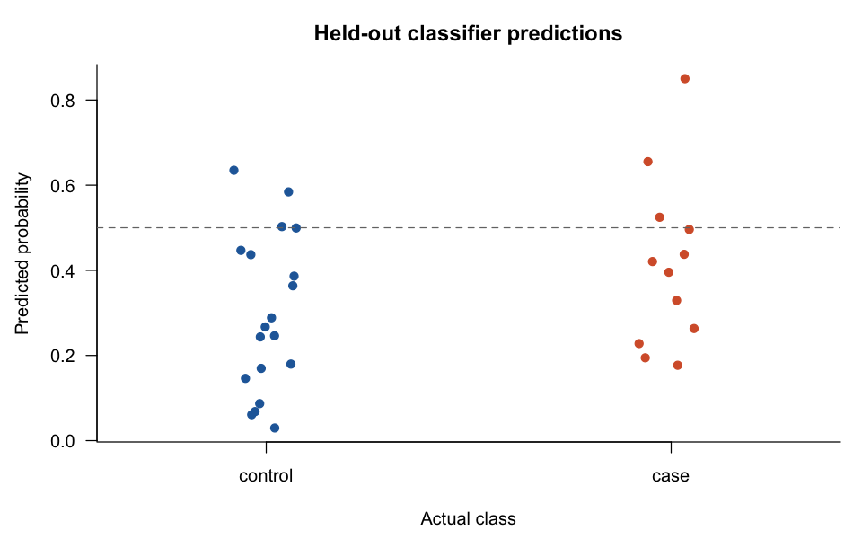 |
| [Markov transitions](../recipes/markov_transitions.R) | 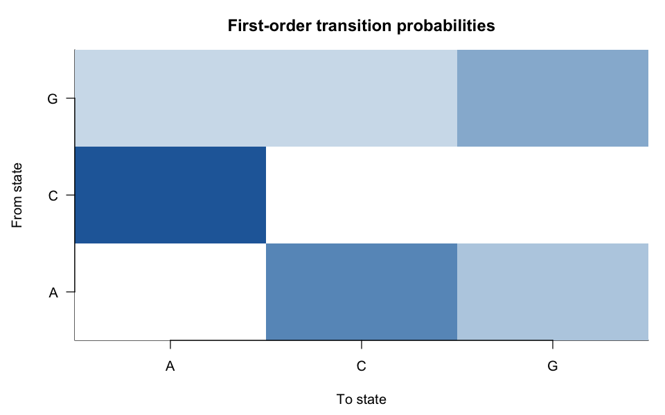 |
| [Metabolomics fold change](../recipes/metabolomics_fold_change.R) | 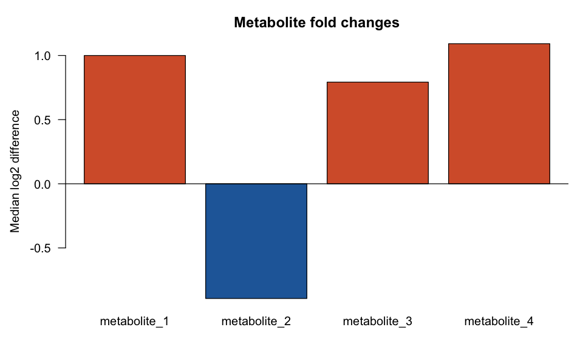 |
| [Metabolomics missingness](../recipes/metabolomics_missingness.R) | 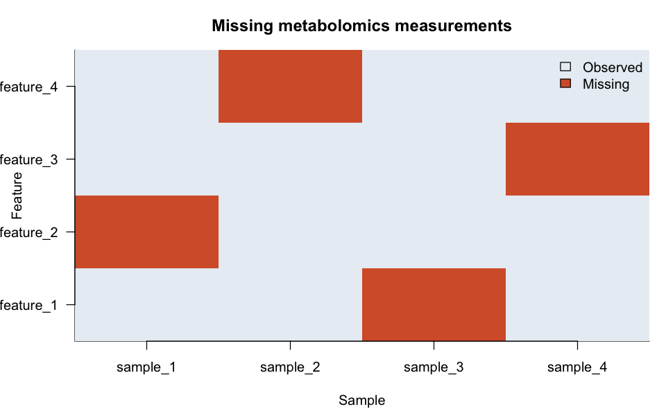 |
| [Variant allele frequency](../recipes/variant_allele_frequency.R) | 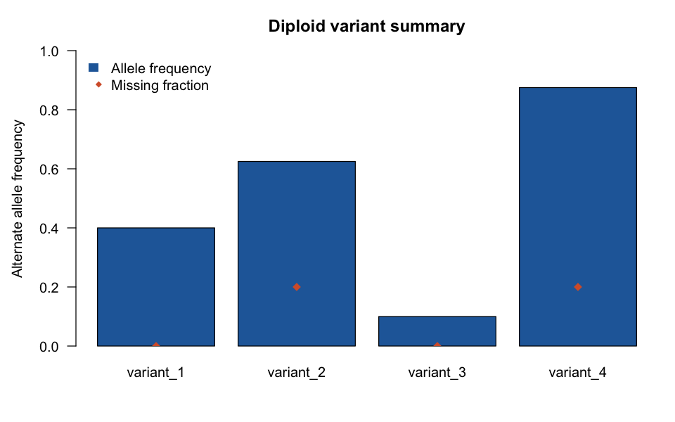 |
