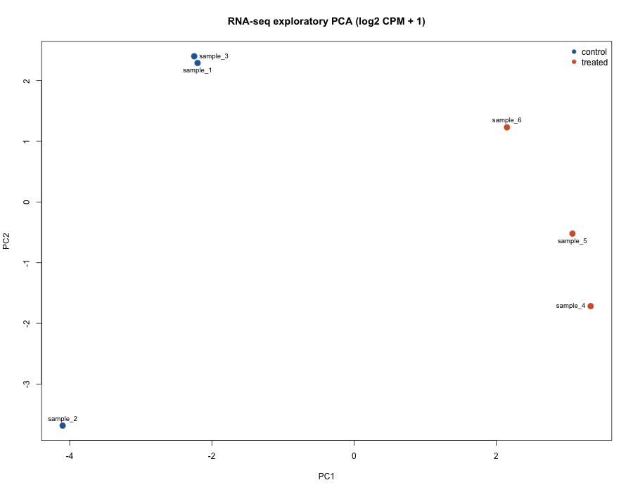

# RNA-seq: counts to QC and differential expression

This example accepts a **gene count matrix**, not FASTQ files. It produces library-size and PCA checks, DESeq2 differential-expression results, a volcano plot, and R session details. It is a small workflow for learning and adaptation; a real study still needs a suitable experimental design, sequencing QC, annotation checks, and biological interpretation.

If you only have paired FASTQ files, use [`fastq_qc.R`](fastq_qc.R) for a quick check of the first read pairs. It reports lengths, mean Phred+33 scores, and GC fractions; it does **not** align reads or create a count matrix:

```bash
Rscript workflows/rnaseq/fastq_qc.R reads.R1.fastq.gz reads.R2.fastq.gz fastq_qc_output 10000
```

This quick check reads only the requested first pairs. Before analysis, run `gzip -t` on **each complete `.fastq.gz` file** to detect truncation or checksum errors elsewhere in the archive.

For a small real-data file-format example, see the owner-approved [seagrass FASTQ excerpts](real_fastq/README.md). These excerpts are separate from the synthetic count matrix below and cannot be used for differential expression.

## Input

`counts.csv`: first column `gene_id`; every other column is one sample of nonnegative integer gene counts. `samples.csv`: one row per sample with `sample_id` and `condition`. IDs must match exactly; sample-sheet rows may be in a different order. Use at least two biological replicates in each of exactly two groups. Technical replicates do not count as independent biological replicates.

The files under [`example/`](example/) are **synthetic**, created by [`make_example_data.R`](make_example_data.R). They are safe to share and are not the author's seagrass RNA-seq data.

## Run

Install [BiocManager](https://bioconductor.org/install/) and DESeq2 once in R:

```r
install.packages("BiocManager")
BiocManager::install("DESeq2")
```

From the repository root:

```bash
Rscript workflows/rnaseq/run.R \
  workflows/rnaseq/example/counts.csv \
  workflows/rnaseq/example/samples.csv \
  workflows/rnaseq/example/output control treated
```

Replace the first two paths with your own files and choose a new output folder. The last two arguments identify the reference and case groups; reported log2 fold change is **case divided by reference**. The output folder contains `library_sizes.csv`, `pca_coordinates.csv`, `pca.png`, `deseq2_results.csv`, `volcano.png`, and `session_info.txt`.

| Exploratory sample structure | Differential-expression result |
|---|---|
|  |  |

The PCA uses log2(CPM + 1) only for exploratory QC. For inference, DESeq2 fits a negative-binomial model to **raw integer counts**. Genes with fewer than two samples having at least 10 counts are excluded. Review sample clustering, batch structure, counts, and the design before interpreting adjusted p-values. DESeq2 may report `NA` for some p-values or adjusted p-values; these are retained in the output. See the [official DESeq2 vignette](https://bioconductor.org/packages/release/bioc/vignettes/DESeq2/inst/doc/DESeq2.html) for the method and more complex designs.
